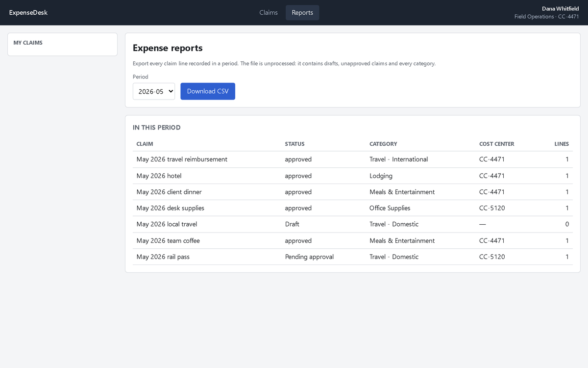

<div align="center">

# skillproof

### Turn a demonstration into an agent skill that survives the page changing.

**Do a repetitive browser task once, by hand. Get back a skill an agent can run — and a completion check that says what it could not verify.**

```bash
git clone https://github.com/hccccc01333/skillproof && cd skillproof && bash setup.sh
```

[](LICENSE)
[](#requirements)
[](#verify-it-yourself)

[What you get](#what-you-get) · [Why you can trust it](#why-you-can-trust-it) · [Verify it yourself](#verify-it-yourself) · [Record your own](#record-your-own-workflow) · [What it does not claim](#what-this-does-not-claim)

</div>



---

You have a task you do in a web app every week. Export from three systems,
cross-check, build a table, send it on. Two hours, and only you know how.

Show it once. `skillproof` watches what you did, works out the procedure, and
writes a skill an agent can run — including the rules you never wrote down,
because it asks you about the ones it cannot work out for itself.

## What you get

**A `SKILL.md`.** A written procedure an agent can follow, parameterised over
the parts that change — which month, which rows, which amounts — instead of the
values from the day you recorded it.

**A `verify.json`.** Machine-checkable assertions that decide whether the task
actually succeeded. The executor's `done` is refused while they fail.

**A declared gap.** Whatever the skill cannot check is stated, not approximated.
From a generated verifier, unedited:

```
A1  file_exists        report.json
A2  json_field_equals  report.json:period
A3  json_field_equals  report.json:claim_count
A4  unverifiable       whether each excluded claim was excluded for the correct reason
```

`A4` is the point.

## Why you can trust it

Because the numbers include the baseline nobody runs.

Everyone measures a new agent method against **doing nothing**. Nobody measures
it against the cheap alternative: **replaying the demonstration**. So we did. A
recording replayed verbatim, no model involved:

| | the page it was recorded from | after a UI revision that also drops the test hooks |
|---|---|---|
| **a recording** | **100 / 100** | **25 / 100** |
| **a skill + its verifier** | 100 / 100 | **100 / 100** |

A recording is perfect until the page moves, and then it is worth 75 points
less. That is the gap a skill has to close, and it is the only gap worth closing.

And the reason the completion check exists:

> We measured 6 agent runs that declared the task finished. **4 of them were
> wrong.** All four said "successfully submitted" while scoring 70–85.

| task | original agent | recording | skill + verifier |
|---|---|---|---|
| claim submission | 56.7 | 100 (demo page) / 25 (revised) | **100 · SR 100** |
| period report | 35.0 | — | **100 · SR 100** |
| period report, two non-legible rules | 20.0 | — | **100 · SR 100** |

## Verify it yourself

```bash
.venv/Scripts/python.exe reproduce.py          # 11s, four decisive cells
.venv/Scripts/python.exe reproduce.py --all    # 21s, all twelve
```

No model, no API key, no credentials. The numbers are **asserted, not derived**
— they were published before the script existed — so a change in behaviour fails
the check instead of quietly becoming a new baseline.

```bash
.venv/Scripts/python.exe tests/test_tools.py   # 24 tool-surface + verifier contracts
```

## Record your own workflow

```bash
.venv/Scripts/python.exe record_session.py \
    --url https://your-intranet/reports \
    --episode monthly-report \
    --instruction "Prepare the monthly expense report and save it as report.json" \
    --workspace ./work
```

A browser opens with the evidence hook installed. Do the task once, at your own
pace, saving whatever the task is supposed to produce. Close the window; the
episode is written.

```bash
.venv/Scripts/python.exe run_induct.py --episode monthly-report --interactive
```

`--interactive` puts the induction's questions to you on stdin. Answer in your
own words — a rambling spoken sentence works exactly as well as a written one;
we tested both and got identical scores.

Induction needs a model endpoint (`S2S_INDUCT_BASE_URL`, `S2S_INDUCT_API_KEY`,
`S2S_INDUCT_MODEL`). **Everything else — recording, replaying, scoring, and the
whole benchmark — runs without one.**

## How it works

The recording captures more than clicks. Each action is resolved to the UI
element it landed on, by role and accessible name, alongside the frames before
and after — which is what lets a skill name a control semantically instead of
remembering where it was.

The induction then does the part that turned out to matter most: it reconciles
**what the demonstration consumed against what it produced**. Rules that appear
in no data field are often visible as a difference between those two artifacts,
and an induction that only reads the evidence misses them.

A recorded run of this repo's benchmark scored **35/100** that way — identical to
no skill at all. With the reconciliation step, no human involved, the same model
scored **100/100**.

## What this does not claim

- **Unattended automation of anything.** A recording beats everything on the page
  it came from, and an induction cannot invent a rule that was never observable.
- **That the tasks are neutral.** They were designed by the person who wrote the
  method. That is the standard credibility hole for a benchmark like this, and
  the mitigation is that the rules are [written down](docs/policies/expense-policy.md)
  with a rubric mapping, so the scoring can be checked rather than believed.
- **That it generalises.** Two tasks, one model, 3–6 runs per cell. Someone
  re-running this will get different numbers.
- **That the verifier is mature.** It failed in four distinct ways during
  development, two of them silently, including one that made an agent write the
  wrong file.

## The part we would want you to attack

[docs/results.md](docs/results.md) is 900 lines and most of it is what went
wrong: **eight harness faults** that produced plausible-looking numbers, **four
verifier failure modes**, and twelve runs quarantined as invalid with their
reasons in the filenames.

Two runs scored **100/100 while being unable to finish**, because their verifier
gated completion on something already false. A results table without a `finished`
column would have reported them as successes.

It also records a conclusion we published and then had to correct, and why the
correction happened — we had drawn a conclusion about the mechanism from a
comparison that changed two things at once, which is the same confound this
document criticises the paper for.

If you re-run this and get different numbers, that is the most useful thing you
can send us.

## Requirements

Python 3.11+, and `ffmpeg` on PATH for video. `setup.sh` installs the rest,
including Chromium.

## Layout

```
bench/site/      ExpenseDesk, the target web app — resettable, variant-perturbed
bench/evaluator.py   rubrics, scored from server state (no LLM judge)
recorder/        evidence capture producing the paper-aligned episode schema
induction/       the tool surface, the authoring policy, and the loop
verifier/        completion assertions and the runtime that gates on them
replay/          the macro baseline, verbatim and re-parameterised
executor/        the downstream web agent, for every agent condition
docs/            results, the format spec, the published policy, a roadmap critique
reproduce.py     the 11-second verification
record_session.py    record a workflow you drive yourself
```

## Relationship to Work2Skill

An independent reimplementation and extension of
[Work2Skill](https://arxiv.org/abs/2610.12984) (arXiv:2610.12984), on a web
target instead of a desktop one. The episode schema follows the paper's
Appendix B, so a reader written for it can read these episodes.

The contribution here is the baseline the paper does not run, and the
measurement discipline around it.

## License

MIT.
