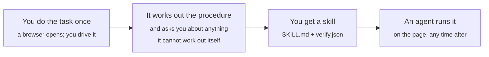

<div align="center">

# skillproof

### Record a browser task once. Get back a skill an agent can run — and a completion check that says what it could not verify.

```bash
git clone https://github.com/hccccc01333/skillproof && cd skillproof && bash setup.sh
```

[](https://github.com/hccccc01333/skillproof/actions/workflows/verify.yml)
[](LICENSE)
[](#requirements)
[](#verify-it-yourself)

[How it works](#how-it-works) · [What you need](#what-you-need) · [Why you can trust it](#why-you-can-trust-it) · [Verify it yourself](#verify-it-yourself) · [What this does not claim](#what-this-does-not-claim)

</div>

---

## How it works



The recording captures more than clicks. Every action is resolved to the UI
element it landed on — by role and accessible name — alongside the frames before
and after. That is what lets the skill name a control semantically instead of
remembering where it was on the day you recorded.

## What you need

| | |
|---|---|
| **Python 3.11+** | `setup.sh` handles the rest, including Chromium |
| **A model endpoint** | any OpenAI-compatible one, for the induction step only |

```bash
export S2S_INDUCT_BASE_URL=https://api.example.com/v1
export S2S_INDUCT_API_KEY=...
export S2S_INDUCT_MODEL=<a model id your endpoint serves>
```

**Recording, running an induced skill, replaying, and the entire benchmark work
without one.** So does verifying every claim on this page — `reproduce.py`
touches Playwright and nothing else.

## Why you can trust it

Because the numbers include the baseline nobody runs.

Everyone measures a new agent method against **doing nothing**. Nobody measures
it against the cheap alternative: **replaying the demonstration**. So we did. A
recording replayed verbatim, no model involved:

| | the page it was recorded from | after a UI revision that also drops the test hooks |
|---|---|---|
| **a recording** | **100 / 100** | **25 / 100** |
| **a skill + its verifier** | 100 / 100 | **100 / 100** |

A recording is perfect until the page moves, and then it is worth 75 points
less. That is the gap a skill has to close, and it is the only gap worth closing.

And the reason the completion check exists:

> We measured 6 agent runs that declared the task finished. **4 of them were
> wrong.** All four said "successfully submitted" while scoring 70–85.

| task | original agent | recording | skill + verifier |
|---|---|---|---|
| claim submission | 56.7 | 100 (demo page) / 25 (revised) | **100 · SR 100** |
| period report | 35.0 | — | **100 · SR 100** |
| period report, two non-legible rules | 20.0 | — | **100 · SR 100** |

Those tasks run against **ExpenseDesk**, a small resettable web app in this repo
([`bench/site`](bench/site)) built so every condition starts from an identical
state. It is a test harness, not the product.

## What it costs

Every number above is about success. None of them says what it costs, and the
answer is not the one a skills pitch would want.

Like for like, same task, same model, one skill version at a time:

| task | | tokens | steps | score |
|---|---|---|---|---|
| `expense-report` | no skill | 56,281 | 9.0 | 35.0 |
| | **with skill** | **45,765** | **7.3** | **100.0** |
| `expense-submit` | no skill | 96,766 | 12.2 | 56.7 |
| | **with skill** | 213,448 | 19.0 | **100.0** |
| `expense-report-hard` | no skill | 33,254 | 7.0 | 20.0 |
| | **with skill** | 195,284 | 17.3 | **100.0** |

**It goes both ways and the direction is not predictable from the task.** On the
reporting task the skill is *cheaper* and scores 65 points higher. On the other
two it costs two to six times as much for the points it gains.

The reason is in the steps column. **The agent with no skill is cheap because it
quits early** — it stops after the first receipt, or before checking its work,
and reports success. The skill makes it do the job: 19 steps instead of 12. The
extra tokens are not overhead, they are the work that was being skipped.

So the honest cost model is: **a skill trades tokens for success, and the
exchange rate depends on how badly the unaided agent does.** Where the baseline
already scores in the nineties there is nothing to buy. Where it scores in the
twenties, the tokens buy eighty points.

Induction is a one-time cost per task: **167k–293k tokens, median 221k, 11–17
turns.** It never pays itself back in tokens. It pays back the first time the
task would otherwise have been done wrong, which is a business judgement rather
than a technical one.

One caveat that makes these numbers pessimistic for the skill: **the harness
sends no cache breakpoint.** The skill text rides in the system prompt and is
re-sent on every step, where prompt caching would make most of it nearly free.
The step-count difference — the part that actually matters — would not change.

## Verify it yourself

```bash
.venv/Scripts/python.exe reproduce.py          # 11s, four decisive cells
.venv/Scripts/python.exe reproduce.py --all    # 21s, all twelve
```

**Playwright is the only dependency it touches** — not the model client, not
ffmpeg. The numbers are **asserted, not derived**: they were published before
the script existed, so a change in behaviour fails the check instead of quietly
becoming a new baseline.

```bash
.venv/Scripts/python.exe tests/test_tools.py       # tool-surface + verifier contracts
.venv/Scripts/python.exe tests/test_artifacts.py   # the shipped episodes and skills
```

The second one exists because shipped data rots silently. It found a real defect
on its first run: an episode with a screenshot on disk that its own index did
not list.

## Record a task

```bash
.venv/Scripts/python.exe record_session.py \
    --url https://your-intranet/reports \
    --episode monthly-report \
    --instruction "Prepare the monthly expense report and save it as report.json" \
    --workspace ./work
```

A browser opens with the evidence hook installed. Do the task once, at your own
pace, saving whatever it is supposed to produce. Close the window; the episode
is written.

```bash
.venv/Scripts/python.exe run_induct.py --episode monthly-report --interactive
```

`--interactive` puts the induction's questions to you on stdin. Answer in your
own words — a rambling spoken sentence works exactly as well as a written one;
we tested both and got identical scores. Expect one question per rule the
recording cannot carry: a two-rule task asked two.

## Run the skill

```bash
.venv/Scripts/python.exe run_skill.py \
    --skill induced/monthly-report \
    --url https://your-intranet/reports \
    --instruction "Prepare the May 2026 expense report and save it as report.json" \
    --workspace ./work
```

Any page. The instruction is the goal — the skill supplies the procedure, this
supplies the target and the values. The skill's own verifier runs at the end and
its declared gaps print beside its checks:

```
verifier: PASSED (2 runs, 0 completion attempts refused)
  [PASS] A1: The report was saved as report.json in the workspace root
  [PASS] A3: Exactly the reimbursable claims of the period were counted
  [GAP ] A6: whether every claim already settled outside this reimbursement run
             was excluded cannot be checked
```

A gap is not a failure. It is the part of the task the skill is telling you it
could not confirm — which is the difference between an automation you can rely
on and one that reports success it cannot support.

There is no score here, deliberately: there is no rubric for your workflow, and
inventing one would be guessing at what you meant.

## What this does not claim

- **Unattended automation of anything.** A recording beats everything on the page
  it came from, and an induction cannot invent a rule that was never observable.
- **That the tasks are neutral.** They were designed by the person who wrote the
  method. That is the standard credibility hole for a benchmark like this, and
  the mitigation is that the rules are [written down](docs/policies/expense-policy.md)
  with a rubric mapping, so the scoring can be checked rather than believed.
- **That the benchmark numbers generalise.** They come from two tasks, one
  model, 3–6 runs per cell, on an app written for the benchmark. Someone
  re-running this will get different numbers. What has been checked against a
  site this project does not own is in [Beyond the benchmark](#beyond-the-benchmark),
  and it is one workflow on one site.
- **That the verifier is mature.** It failed in four distinct ways during
  development, two of them silently, including one that made an agent write the
  wrong file.
- **That it saves anything.** On two of three tasks a skill costs more tokens
  than no skill, not fewer, and induction never pays for itself in tokens. See
  [What it costs](#what-it-costs).

## The part we would want you to attack

[docs/results.md](docs/results.md) is mostly what went wrong: **eight harness
faults** that produced plausible-looking numbers, **four verifier failure
modes**, and twelve runs quarantined as invalid with their reasons in the
filenames.

Two runs scored **100/100 while being unable to finish**, because their verifier
gated completion on something already false. A results table without a `finished`
column would have reported them as successes.

It also records a conclusion we published and then had to correct, and why — we
had drawn a conclusion about the mechanism from a comparison that changed two
things at once, which is the same confound that document criticises the paper
for.

If you re-run this and get different numbers, that is the most useful thing you
can send us.

## Entry points

| | |
|---|---|
| `setup.sh` · `setup.ps1` | install, then verify the published numbers |
| `reproduce.py` | check every claim on this page — no model, no credentials |
| `record_session.py` | record a task you drive yourself |
| `run_induct.py` | turn a recording into a skill; `--interactive` to answer its questions |
| `run_skill.py` | run an induced skill against any page |
| `run_macro.py` · `run_exec.py` · `run_sample.py` | the benchmark: baselines and agent conditions |
| `run_verifier_gen.py` | generate a completion verifier for an existing skill |

## Layout

```
bench/site/          ExpenseDesk, the resettable app the benchmark runs against
bench/evaluator.py   rubrics, scored from server state (no LLM judge)
recorder/            evidence capture, producing the episode schema
induction/           the tool surface, the authoring policy, and the loop
verifier/            completion assertions and the runtime that gates on them
replay/              the macro baseline, verbatim and re-parameterised
executor/            the downstream web agent, for every agent condition
docs/                results, the format spec, the published policy
```

## Requirements

Python 3.11+, and `ffmpeg` on PATH for video. `setup.sh` (or `setup.ps1` on
Windows without Git Bash) installs the rest from `requirements.txt`.

| | needed for |
|---|---|
| `playwright` | recording, replaying, running a skill, and `reproduce.py` |
| `pillow` | downscaling evidence frames before they reach a model |
| `openai` | induction only — nothing else imports it |

## Beyond the benchmark

Every number above was measured on an app written for the benchmark, which is
the obvious objection to all of it. So the same comparison was run against
**saucedemo.com** — a public demo storefront this project does not own, on a
real multi-step workflow: log in, compare six prices, add the cheapest item,
check out.

A third-party site cannot be revised the way the benchmark revises its own app.
What *can* be revised is what the browser sees, and from the agent's side that
is the same thing: the names and hooks it learned are no longer there.

```bash
.venv/Scripts/python.exe bench/external/saucedemo.py             # record
.venv/Scripts/python.exe run_induct.py --episode saucedemo        # induce

.venv/Scripts/python.exe bench/external/harness.py --mode replay
.venv/Scripts/python.exe bench/external/harness.py --mode replay --perturb
.venv/Scripts/python.exe bench/external/harness.py --mode replay --perturb --strong
.venv/Scripts/python.exe bench/external/harness.py --mode skill  --perturb --strong
```

| | site as-is | controls renamed | renamed, hooks regenerated |
|---|---|---|---|
| **replay** the recording | **completed** | **completed** | **failed** — 8 of 14 steps, no order |
| **skill** + verifier | — | — | **completed**, verifier passed |

**The recording survives a rename, and that is worth knowing.** Four of its
steps fell through to the structural CSS path it also carries —
`input#login-button` — so the words could move without the target moving. It
takes losing the hooks as well to break it, which is exactly what the
benchmark's `relayout` versus `relayout-nostid` pair showed. A claim that
renaming alone breaks a recording would have been wrong, and this is where we
found that out.

The induction, from that demonstration, **asked nothing** — it derived the
procedure including the price comparison — and produced a skill with no item
name, no price and no `$7.99` anywhere in it. It then completed the same task on
the same perturbed page where the recording could not.

The verifier checked three things it could and **declared two it could not**,
including the judgement itself:

```
2 thing(s) this skill cannot check:
  - That the single ordered line item is the lowest-priced product in the
    catalog, in quantity 1, cannot be checked from the confirmation page
  - That checkout was completed with the task's supplied customer name and
    postal code cannot be checked: it restates neither
```

**The skill carries the rule and the verifier still cannot confirm it was
applied**, because the confirmation page does not say what you bought. That is
the honest limit of the whole approach, visible here more clearly than anywhere
in the benchmark.

Two things a third-party site costs, neither worked around: there is no reset
endpoint and no state API, so evaluation reads the rendered page; and nothing
pins the site, so a real change to it breaks this harness rather than being
absorbed.

It also found a capture defect on the second action. Every control in the
benchmark app is a `<button>` with text, so name resolution never had to handle
`<input type="submit" value="Login">` — an input has no text content, so the
accessible name came back empty and a skill induced from that recording would
have had nothing to name the control by. Fixed in `recorder/capture.js`. The
benchmark could not have exposed that; a real page did, immediately.

## What this builds on

Three things are borrowed, and they are the scaffolding rather than the argument:

- **The shape of the recording data.** An episode is a task, a normalized action
  trace, and indexed evidence frames, so that a program written for that shape
  reads these episodes unchanged.
- **The idea of giving the induction agent a small set of evidence-exploration
  tools** — read a file, look at a frame, sample a video — rather than loading
  the whole recording into context.
- **The structure of the skill-authoring policy**, which asks for semantic
  targets, phase boundaries and observable completion checks.

What this project adds: a web target instead of a desktop one, the macro
baseline nobody runs, a completion verifier that refuses `done` and declares
what it cannot check, the perturbation ladder the comparison needs, and the
question the induction asks when it cannot work something out on its own.

All three come from **Work2Skill**. The relationship is kept current here rather
than settled once: the borrowed parts may be replaced as this project develops,
and what replaces them is worth recording.
